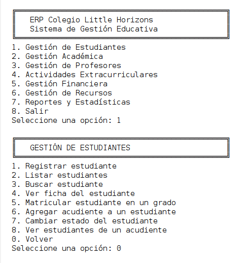
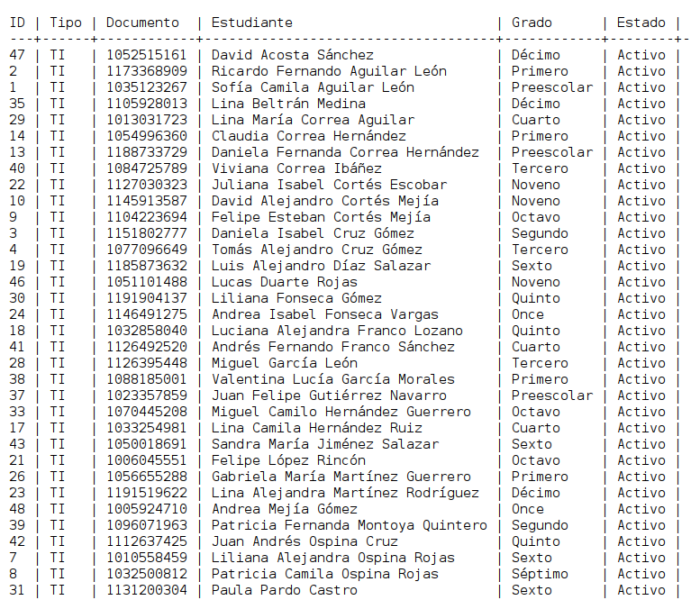

# ERP Colegio Internacional "Little Horizons"

Sistema de Planificación de Recursos Empresariales (ERP) educativo de **consola**, desarrollado en Java con arquitectura **MVC**, acceso a datos con **JDBC** (patrón DAO) y base de datos **MySQL 8**.

---

## 1. Título del Proyecto

**Little Horizons ERP – Sistema de Gestión Educativa**

## 2. Descripción

### 2.1 Propósito
Centralizar y automatizar los procesos académicos, extracurriculares, financieros y de recursos del colegio, reemplazando los registros en papel y las hojas de cálculo dispersas.

### 2.2 Problemas que resuelve
- Información de estudiantes, acudientes y profesores dispersa e inconsistente.
- Cálculo manual de promedios y falta de historial académico.
- Seguimiento deficiente de inasistencias, morosos y préstamos vencidos.
- Facturación manual sin trazabilidad.

### 2.3 Funcionalidades principales
Cinco módulos accesibles desde un menú de consola: estudiantes, académico, profesores, extracurriculares, financiero (con **facturas PDF**), recursos/préstamos y reportes (ver sección 10).

## 3. Autores

| Nombre completo | Correo electrónico | Contacto |
|---|---|---|
| *[Luis Alejandro Abreo Carrillo]* | *[alejandro.abreo39@gmail.com]* | *[ LuisAlejandroAbreo]* |

## 4. Tecnologías Utilizadas

| Elemento | Detalle |
|---|---|
| Lenguaje | Java 8+ (compila con `javac.source/target = 1.8`; probado con JDK 21) |
| IDE | Apache NetBeans (proyecto **Java with Ant**) |
| Base de datos | MySQL 8.0 o superior |
| Librerías externas | **MySQL Connector/J 8.x** (única dependencia). El PDF se genera con una clase propia (`SimplePdf`), sin librerías. |

## 5. Requerimientos Previos

- **JDK 8 o superior** (recomendado JDK 17 o 21).
- Apache NetBeans (cualquier versión reciente) con soporte Java SE / Ant.
- **MySQL Server 8.0 o superior** (**requerido**: el script usa restricciones `CHECK`, que solo se aplican en 8.0.16+).
- MySQL Connector/J 8.x (`mysql-connector-j-8.x.x.jar`).
- Git (para clonar el repositorio).

## 6. Configuración de la Base de Datos

### 6.1 Creación de la base de datos
Desde la raíz del proyecto:

```bash
mysql -u root -p --default-character-set=utf8mb4 < docs/database.sql
```

El script elimina y vuelve a crear la base `erp_little_horizons`, crea las tablas (DDL, sección 1) y carga los datos de prueba (DML, sección 2). También puede ejecutarlo desde MySQL Workbench (*File > Open SQL Script > Run*).

### 6.2 Configuración de credenciales
Copie `db.properties.example` a `db.properties` (en la raíz del proyecto, junto a `build.xml`) y edite:

```properties
db.url=jdbc:mysql://localhost:3306/erp_little_horizons?useSSL=false&allowPublicKeyRetrieval=true&serverTimezone=America/Bogota&characterEncoding=UTF-8
db.user=root
db.password=su_clave
```

Si el archivo no existe se usan los valores por defecto (`root` sin clave, `localhost:3306`).

### 6.3 Instalación del driver JDBC
1. Descargue **Connector/J** (Platform Independent) desde <https://dev.mysql.com/downloads/connector/j/> y extraiga el `.jar`.
2. En NetBeans: clic derecho en el proyecto → **Properties → Libraries → Classpath → Add JAR/Folder** → seleccione `mysql-connector-j-8.x.x.jar`.

### 6.4 Cambios al script base (justificados)
Se agregaron dos tablas porque el enunciado lo exige y el esquema base no podía almacenarlo:
- `horarios_clase`: días y horas de cada asignación profesor–materia (detección de conflictos).
- `valores_concepto_estudiante`: valor diferenciado por estudiante (descuento por hermanos, becas).

## 7. Instalación y Ejecución

### 7.1 Clonar el repositorio
```bash
git clone https://github.com/<usuario>/little-horizons-erp.git
```
### 7.2 Abrir el proyecto en el IDE
NetBeans → **File → Open Project…** → seleccione la carpeta `LittleHorizonsERP` (se reconoce por el ícono de taza de café).
### 7.3 Compilar
Clic derecho en el proyecto → **Clean and Build** (`Shift+F11`).
### 7.4 Ejecutar
Clic derecho en el proyecto → **Run** (`F6`). La interacción se hace en la ventana **Output** (escriba la opción y presione Enter).

## 8. Estructura del Proyecto

```
LittleHorizonsERP/
├── build.xml, manifest.mf, nbproject/     Archivos del proyecto NetBeans (Ant)
├── db.properties                          Credenciales de la base de datos
├── docs/database.sql                      DDL + DML
├── facturas/                              PDF generados (se crea automáticamente)
├── error_log.txt                          Log de errores (se crea automáticamente)
└── src/com/littlehorizons/erp/
    ├── Main.java                          Punto de entrada y ensamblaje (inyección manual)
    ├── model/                             Entidades del dominio (POJOs)
    ├── view/                              Menús y formularios de consola
    ├── controller/                        Reglas de negocio y validaciones
    ├── dao/ y dao/impl/                   Interfaces DAO e implementaciones JDBC
    └── util/                              Conexión, JDBC helper, logger, entrada/salida, PDF
```

**Flujo MVC:** `view` (lee/valida entradas y muestra) → `controller` (reglas de negocio) → `dao` (SQL con `PreparedStatement`) → `model` (datos). Las vistas nunca ejecutan SQL y los DAO nunca imprimen.

## 9. Principios y Patrones de Diseño Aplicados

### 9.1 Principios SOLID
- **S – Responsabilidad única:** `InputReader` solo lee/valida entradas; `ConsoleUI` solo imprime; `InvoicePdfGenerator` solo arma la factura; `FinanceController` solo reglas financieras.
- **O – Abierto/Cerrado:** para otro tipo de reporte basta añadir un método en `ReportDao`/`ReportDaoImpl` sin modificar el resto; `SimplePdf` se reutiliza para otros documentos.
- **L – Sustitución de Liskov:** cualquier `StudentDao` (JDBC, en memoria para pruebas) puede sustituir a `StudentDaoImpl` sin alterar el comportamiento de `StudentController`.
- **I – Segregación de interfaces:** interfaces pequeñas por agregado (`ClubDao`, `LoanDao`, `InvoiceDao`…) en lugar de un DAO gigante.
- **D – Inversión de dependencias:** los controladores dependen de interfaces `*Dao`; `Main` inyecta las implementaciones por constructor.

### 9.2 Patrones de diseño
| Patrón | Dónde | Justificación |
|---|---|---|
| **MVC** | paquetes `model`, `view`, `controller` | Separar presentación, lógica y datos |
| **DAO** | `dao/` + `dao/impl/` | Aislar el SQL del resto de la aplicación |
| **Singleton** | `DatabaseConnection` | Una única configuración de conexión (holder idiom, thread-safe) |
| **Template Method (helper)** | `util/Jdbc` | Centraliza `PreparedStatement`, `try-with-resources`, transacciones y manejo de errores |
| **Dependency Injection** | `Main` | Ensamblado explícito de DAOs → controladores → vistas |

## 10. Funcionalidades Principales

- **1. Gestión de Estudiantes:** registro con acudiente obligatorio (un acudiente puede tener varios hijos), fichas, búsqueda por nombre/documento, matrícula por grado y año, cambio de estado, asociación de acudientes.
- **2. Gestión Académica:** materias por grado, inscripción por período (individual o todas las del grado), registro de notas 0.0–5.0 (valida inscripción y asignación del profesor), historial, promedios por materia/período/general/curso (Stream API), asistencia diaria.
- **3. Gestión de Profesores:** registro, asignación de materias, carga académica, horarios con detección de conflictos (profesor y grupo).
- **4. Extracurriculares:** clubes con **validación de cupo atómica** (transacción con bloqueo `FOR UPDATE`), retiro, eventos, participantes y posiciones (solo eventos con competencia).
- **5. Financiero:** catálogo de conceptos, valores personalizados por estudiante, registro de pagos con número de recibo, historiales por estudiante/acudiente, morosos (sin pensión en más de un mes) y **factura electrónica PDF** automática (CUFE simulado SHA-384, QR simulado, resolución DIAN simulada, IVA 19 % solo en uniformes).
- **6. Recursos:** inventario por categoría y estado, préstamos a estudiantes y profesores (transaccionales), devoluciones, préstamos vencidos.
- **7. Reportes:** inasistencias (> N ausencias en una semana), morosos, préstamos vencidos, participación en eventos, estudiantes por grado, ocupación de clubes, mejores promedios.

## 11. Manejo de Errores y Logs

- **Logging:** `AppLogger` escribe en **`error_log.txt`** (raíz del proyecto) con fecha, nivel y *stack trace*.
- **Excepciones:** los DAO convierten `SQLException` en `ErpException` con mensajes comprensibles (duplicados, conexión, etc.); las vistas capturan y muestran el mensaje sin cerrar el programa (`BaseView.safely`).
- **Recursos:** todo `Connection`, `PreparedStatement` y `ResultSet` se cierra con *try-with-resources*; todas las consultas usan `PreparedStatement`.
- **Transacciones:** préstamos, devoluciones e inscripción a clubes hacen `commit`/`rollback` explícito.

## 12. Capturas del proyecto



## 13. Problemas Conocidos y Limitaciones
- La factura cumple el formato visual pero el **CUFE, el QR y la resolución DIAN son simulados**; no tiene validez fiscal.
- Aplicación monousuario de consola, sin autenticación.
- La contraseña de la base de datos se guarda en `db.properties` en texto plano (no suba ese archivo al repositorio).

## 14. Futuras Mejoras
Autenticación por roles, pool de conexiones, pruebas unitarias con DAOs simulados, exportación de reportes, interfaz gráfica o web.

## 15. Licencia
Proyecto académico. Uso educativo.

## 16. Contacto
*[Luis Alejandro Abreo Carrillo] – [alejandro.abreo39@gmail.com]*
